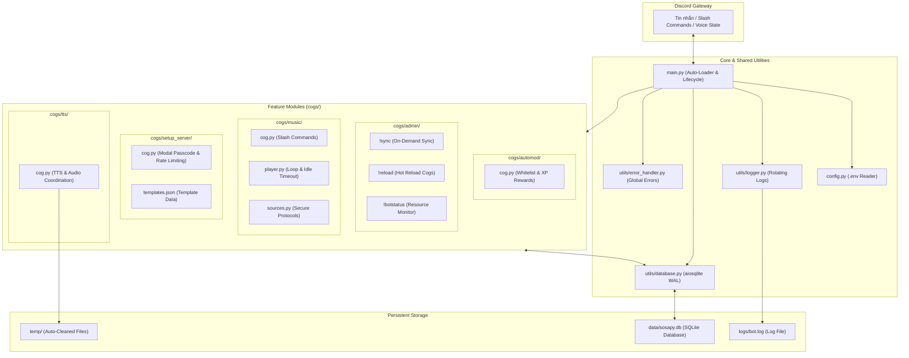

# 🤖 SosaPy — All-in-One Discord Bot

<p align="center">
  <b>Hệ thống Discord Bot đa chức năng, kiến trúc từng tính năng một thư mục riêng biệt (Feature-Folder Architecture), tích hợp SQLite bất đồng bộ (aiosqlite WAL Mode) siêu nhẹ và tối ưu cho VPS.</b>
</p>

<p align="center">
  
  
  
  
  
</p>

---

## 📑 Mục Lục
- [1. Giới Thiệu Dự Án](#1-giới-thiệu-dự-án)
- [2. Kiến Trúc Cơ Sở Dữ Liệu: Vì Sao Dùng SQLite Siêu Nhẹ Trên VPS?](#2-kiến-trúc-cơ-sở-dữ-liệu-vì-sao-dùng-sqlite-siêu-nhẹ-trên-vps)
- [3. Kiến Trúc Hệ Thống & Tính Năng Nổi Bật](#3-kiến-trúc-hệ-thống--tính-năng-nổi-bật)
- [4. Cấu Trúc Thư Mục Chuẩn Hóa (Feature-Folder)](#4-cấu-trúc-thư-mục-chuẩn-hóa-feature-folder)
- [5. Hướng Dẫn Cài Đặt & Triển Khai Toàn Diện](#5-hướng-dẫn-cài-đặt--triển-khai-toàn-diện)
  - [Cách 1: Chạy trực tiếp (Python trên Windows / Linux)](#cách-1-chạy-trực-tiếp-python-trên-windows--linux)
  - [Cách 2: Triển khai 1-click bằng Docker trên VPS](#cách-2-triển-khai-1-click-bằng-docker-trên-vps)
- [6. Cấu Hình Biến Môi Trường (.env)](#6-cấu-hình-biến-môi-trường-env)
- [7. Hướng Dẫn Sử Dụng & Bảng Lệnh](#7-hướng-dẫn-sử-dụng--bảng-lệnh)
  - [7.1. Lệnh Quản Trị Hệ Thống Dành Cho Owner (!sync, !reload)](#71-lệnh-quản-trị-hệ-thống-dành-cho-owner-sync-reload)
  - [7.2. Nhóm Âm Nhạc (Music)](#72-nhóm-âm-nhạc-music)
  - [7.3. Nhóm Giao Tiếp Voice (TTS)](#73-nhóm-giao-tiếp-voice-tts)
  - [7.4. Nhóm Thiết Lập Server Bảo Mật Modal (/setup-server)](#74-nhóm-thiết-lập-server-bảo-mật-modal-setup-server)
  - [7.5. Nhóm Quản Trị Tự Động & Level/Rank (AutoMod)](#75-nhóm-quản-trị-tự-động--levelrank-automod)
- [8. Cơ Chế Xử Lý Lỗi Tập Trung & Bảo Vệ Tài Nguyên](#8-cơ-chế-xử-lý-lỗi-tập-trung--bảo-vệ-tài-nguyên)
- [9. Nhật Ký Cập Nhật & Tiến Độ Làm Việc (Worklog & Changelog)](#9-nhật-ký-cập-nhật--tiến-độ-làm-việc-worklog--changelog)
- [10. Kế Hoạch Phát Triển (Roadmap)](#10-kế-hoạch-phát-triển-roadmap)

---

## 1. Giới Thiệu Dự Án

**SosaPy** là một Discord Bot toàn diện được thiết kế theo kiến trúc **Feature-Folder (Vertical Slice Architecture)**: mỗi tính năng lớn được tổ chức độc lập trong một thư mục riêng trong `cogs/`, giúp loại bỏ hoàn toàn sự phụ thuộc chéo và dễ dàng bảo trì, phát triển lâu dài.

Hệ thống cung cấp đầy đủ các chức năng quan trọng nhất cho cộng đồng Discord:
- **Âm nhạc đa nguồn:** Hỗ trợ YouTube, SoundCloud, Spotify, tự động dọn dẹp hàng đợi và tự rời phòng khi không còn ai nghe.
- **Voice Text-To-Speech (TTS tiếng Việt):** Đọc văn bản bằng giọng nói Google TTS, tự động điều phối với luồng phát nhạc mà không gây xung đột âm thanh.
- **Quản trị an ninh thông minh (AutoMod):** Lọc từ cấm, chặn link ngoài có Whitelist kênh nhạc/media, chống spam tin nhắn và tự động phạt timeout.
- **Hệ thống Level / Rank thời gian thực:** Cộng điểm kinh nghiệm (XP) khi chat hợp lệ và lưu trữ trực tiếp vào SQLite.
- **Thiết lập Server mẫu bảo mật cao:** Dùng hộp thoại **Discord Modal** ẩn mật khẩu, tự động tạo Category, Channel, Role từ file template JSON với cơ chế chống Rate Limit API.

---

## 2. Kiến Trúc Cơ Sở Dữ Liệu: Vì Sao Dùng SQLite Siêu Nhẹ Trên VPS?

> [!TIP]
> **SQLite có cần cài đặt phức tạp trên VPS không?**
> **HOÀN TOÀN KHÔNG!** SQLite được tích hợp sẵn 100% trong Python chuẩn. Khi bạn chạy bot trên VPS, bạn **không cần cài MySQL, PostgreSQL, Redis** hay mở bất kỳ cổng mạng (port) nào.

### Ưu điểm vượt trội của SQLite (`aiosqlite`) so với JSON:
1. **Không nghẽn Disk I/O:** JSON buộc phải đọc và ghi lại toàn bộ file mỗi lần thay đổi 1 giá trị. SQLite chỉ ghi đúng dòng (row) cần cập nhật.
2. **Chế độ WAL (Write-Ahead Logging):** Được kích hoạt sẵn qua `PRAGMA journal_mode = WAL;`. Chế độ này cho phép nhiều lệnh đọc và ghi diễn ra đồng thời mà không bao giờ bị lỗi `database is locked`.
3. **Bảng xếp hạng (Leaderboard) siêu tốc:** SQLite hỗ trợ câu lệnh SQL truy vấn trực tiếp:
   ```sql
   SELECT user_id, xp, level FROM user_levels WHERE guild_id = ? ORDER BY xp DESC LIMIT 10;
   ```
4. **Vẫn là 1 file duy nhất:** Toàn bộ dữ liệu nằm gọn trong file `data/sosapy.db`. Khi cần sao lưu, bạn chỉ cần copy đúng file này sang máy khác.

---

## 3. Kiến Trúc Hệ Thống & Tính Năng Nổi Bật



---

## 4. Cấu Trúc Thư Mục Chuẩn Hóa (Feature-Folder)

```text
SosaPy/
├── .env                          # Lưu biến môi trường bí mật (Token, Key) - KHÔNG ĐẨY LÊN GIT
├── .env.example                  # Mẫu cấu hình môi trường chuẩn
├── .gitignore                    # Bỏ qua cache, file tạm, file database nhạy cảm
├── Dockerfile                    # Đóng gói Docker cài sẵn Python 3.12 + FFmpeg cho VPS
├── docker-compose.yml            # Khởi chạy bot 1-click bằng Docker
├── config.py                     # Quản lý tập trung cấu hình hệ thống
├── main.py                       # Khởi chạy: nạp cogs, SQLite, dọn rác temp, error handler
├── requirements.txt              # Danh sách thư viện (có aiosqlite)
├── README.md                     # Tài liệu kỹ thuật trung tâm
│
├── cogs/                         # THƯ MỤC CHỨC NĂNG (MỖI CHỨC NĂNG 1 FOLDER)
│   ├── admin/                    # [QUẢN TRỊ OWNER] Lệnh !sync, !reload, !botstatus
│   │   ├── __init__.py
│   │   └── cog.py
│   │
│   ├── music/                    # [NGHE NHẠC] YouTube, SoundCloud, Spotify
│   │   ├── __init__.py
│   │   ├── cog.py                # Lệnh slash, kiểm tra phòng trống tự rời
│   │   ├── player.py             # Queue loop, đồng bộ ngắt khi có TTS
│   │   └── sources.py            # yt-dlp và trích xuất Spotify non-blocking
│   │
│   ├── setup_server/             # [SETUP SERVER] Template mẫu và Modal bảo mật
│   │   ├── __init__.py
│   │   ├── cog.py                # Hộp thoại Modal nhập mã bảo mật, chống Rate Limit
│   │   └── templates.json        # Dữ liệu JSON mô tả Category, Channel và Role
│   │
│   ├── tts/                      # [VOICE TTS] Text-To-Speech tiếng Việt
│   │   ├── __init__.py
│   │   └── cog.py                # Lệnh /speak, giới hạn 300 ký tự, non-blocking gTTS
│   │
│   └── automod/                  # [AUTOMOD & RANK] Lọc từ cấm, link rác, cộng XP
│       ├── __init__.py
│       └── cog.py                # Whitelist kênh nhạc, chống rò rỉ RAM, cộng XP SQLite
│
├── data/                         # THƯ MỤC CƠ SỞ DỮ LIỆU
│   └── sosapy.db                 # File SQLite Database đơn giản, siêu nhẹ
│
├── utils/                        # TIỆN ÍCH DÙNG CHUNG
│   ├── __init__.py
│   ├── database.py               # DatabaseManager quản lý SQLite (aiosqlite WAL)
│   ├── error_handler.py          # Bộ xử lý lỗi tập trung cho toàn bộ Slash Commands
│   ├── logger.py                 # Hệ thống ghi log (Console + Rotating File bot.log)
│   └── storage.py                # Hỗ trợ đọc/ghi file JSON an toàn (Lock + Atomic)
│
├── logs/                         # File bot.log xoay vòng tối đa 5MB/file
└── temp/                         # File âm thanh tạm thời (tự dọn dẹp lúc khởi động)
```

---

## 5. Hướng Dẫn Cài Đặt & Triển Khai Toàn Diện

### Cách 1: Chạy trực tiếp (Python trên Windows / Linux)

#### Bước 1: Chuẩn bị FFmpeg & Python
- **Python**: Phiên bản 3.10 trở lên (khuyên dùng Python 3.12).
- **FFmpeg**:
  - *Windows*: Tải từ [gyan.dev FFmpeg](https://www.gyan.dev/ffmpeg/builds/) và thêm vào `Path`.
  - *Ubuntu/Debian VPS*: `sudo apt update && sudo apt install -y ffmpeg python3-venv python3-pip`

#### Bước 2: Tạo môi trường ảo & Cài đặt thư viện
```bash
# Tạo môi trường ảo
python -m venv venv

# Kích hoạt (Windows PowerShell):
.\venv\Scripts\Activate.ps1
# Kích hoạt (Linux VPS):
source venv/bin/activate

# Cài đặt thư viện
pip install -r requirements.txt
```

#### Bước 3: Cấu hình và Khởi chạy
1. Sao chép `.env.example` thành `.env` và điền token:
   ```bash
   cp .env.example .env
   ```
2. Khởi chạy bot:
   ```bash
   python main.py
   ```

---

### Cách 2: Triển khai 1-click bằng Docker trên VPS

Nếu VPS của bạn đã cài sẵn Docker và Docker Compose, bạn không cần phải cài Python hay FFmpeg thủ công:

```bash
# 1. Clone repository về VPS
git clone https://github.com/vdng05/DiscordBot_Sosa.git
cd DiscordBot_Sosa

# 2. Tạo file cấu hình .env
cp .env.example .env
nano .env  # Điền DISCORD_TOKEN và OWNER_IDS của bạn

# 3. Khởi chạy container ngầm trong nền
docker compose up -d --build
```
> [!TIP]
> Container sẽ tự động giữ dữ liệu trong thư mục `./data` và log trong `./logs` ngay trên ổ cứng VPS. Khi reboot VPS, bot sẽ tự động chạy lại nhờ thiết lập `restart: unless-stopped`.

---

## 6. Cấu Hình Biến Môi Trường (.env)

| Tên biến | Mặc định | Ý nghĩa & Khuyến nghị |
| :--- | :--- | :--- |
| `DISCORD_TOKEN` | *(Bắt buộc)* | Token xác thực bot từ Discord Developer Portal. |
| `OWNER_IDS` | *Rỗng* | ID tài khoản Discord của bạn (để sử dụng lệnh `!sync`, `!reload`). |
| `COMMAND_PREFIX` | `!` | Tiền tố lệnh quản trị (dành cho các lệnh `!sync`, `!reload`). |
| `SYNC_ON_STARTUP`| `false` | **Khuyên dùng false**: Không tự động sync khi restart để tránh bị Discord khóa API (Rate Limit). Dùng lệnh `!sync` khi cần. |
| `TTS_MAX_LENGTH` | `300` | Giới hạn số lượng ký tự tối đa cho mỗi lần đọc `/speak` (chống spam âm thanh). |
| `BAD_WORDS` | `từ_cấm_1,toxic` | Danh sách từ cấm ngăn chặn qua AutoMod. |
| `SPAM_LIMIT` | `5` | Số tin nhắn tối đa gửi trong `SPAM_TIME` giây trước khi bị timeout. |
| `SPAM_TIME` | `3` | Khung thời gian kiểm tra spam (giây). |
| `LOG_LEVEL` | `INFO` | Mức độ log: `INFO`, `DEBUG`, `WARNING`, `ERROR`. |

---

## 7. Hướng Dẫn Sử Dụng & Bảng Lệnh

### 7.1. Lệnh Quản Trị Hệ Thống Dành Cho Owner (!sync, !reload)
*Các lệnh này chỉ có chủ bot (`OWNER_IDS`) mới dùng được, dùng tiền tố prefix (`!`):*

- `!sync guild`: Đồng bộ toàn bộ Slash Commands vào Server hiện tại ngay tức thì (dùng khi thử nghiệm tính năng mới mà không lo dính Rate Limit).
- `!sync global`: Đồng bộ toàn bộ Slash Commands ra toàn cầu (Discord mất khoảng 1-10 phút để hiển thị trên tất cả server).
- `!reload <module>`: Tải lại tức thì một module cog (ví dụ: `!reload music` hoặc `!reload automod`) mà không cần tắt bot, không làm gián đoạn phòng nghe nhạc.
- `!status`: Kiểm tra Ping mạng, mức chiếm dụng RAM (MB), thời gian hoạt động liên tục (Uptime) và trạng thái SQLite.

---

### 7.2. Nhóm Lệnh Chung (/help, /rank, /leaderboard)
- `/help`: Xem hướng dẫn sử dụng và danh sách toàn bộ các câu lệnh của bot (phân theo từng danh mục kèm mô tả chi tiết).
- `/rank [member]`: Xem cấp độ (Level), điểm kinh nghiệm (XP) hiện tại và thanh tiến trình thăng cấp của bạn hoặc thành viên khác.
- `/leaderboard`: Xem Bảng vàng Top 10 thành viên có cấp độ và điểm kinh nghiệm cao nhất server.

---

### 7.3. Nhóm Âm Nhạc (Music)
- `/play <query>`: Phát nhạc từ đường link (YouTube, SoundCloud, Spotify) hoặc gõ từ khóa tìm kiếm bài hát.
- `/pause`: Tạm dừng bài hát đang phát trong phòng thoại.
- `/resume`: Tiếp tục phát bài hát đang bị tạm dừng.
- `/skip`: Bỏ qua bài hát hiện tại và tự động chuyển sang bài tiếp theo trong hàng đợi.
- `/queue`: Xem danh sách các bài hát đang chờ phát trong hàng đợi của máy chủ.
- `/leave`: Yêu cầu bot ngắt kết nối khỏi kênh thoại và làm sạch hàng đợi.
- **Tự động tiết kiệm tài nguyên:** Nếu tất cả người dùng rời khỏi phòng (chỉ còn bot) hoặc sau 5 phút không có bài hát mới, bot sẽ tự động ngắt kết nối để giải phóng RAM và CPU.

---

### 7.4. Nhóm Giao Tiếp Voice (TTS)
- `/speak <text>`: Chuyển văn bản tiếng Việt thành giọng nói trong kênh thoại (tối đa 300 ký tự).
- **Điều phối âm thanh thông minh:** Nếu đang phát nhạc, bot sẽ tự động lưu lại bài hát đang nghe dở, đọc thông báo TTS xong rồi mới tiếp tục phát nhạc, không gây xung đột âm thanh `Already playing audio`.

---

### 7.5. Nhóm Thiết Lập Server 3 Bước Xác Nhận (/setup-server)
- `/setup-server [clear_old]`: Khởi tạo toàn bộ cấu trúc Danh mục, Kênh và Quyền theo template mẫu chuẩn.
- **Xác thực 3 Bước nghiêm ngặt:** Chỉ duy nhất **Chủ Server (Server Owner)** mới có quyền thực thi. Hệ thống yêu cầu xác nhận lần lượt qua 3 nút bấm tương tác (Bước 1: Giới thiệu quy mô $\rightarrow$ Bước 2: Cảnh báo mất dữ liệu cũ $\rightarrow$ Bước 3: Xác nhận tối hậu 100%).
- **Loại bỏ Master Key:** Hoàn toàn không cần ghi nhớ hay nhập mật mã thủ công, bảo vệ tối cao dựa trên quyền sở hữu Guild Owner.
- **Chống Rate Limit:** Quá trình xóa và tạo Category/Channel có độ trễ 0.3s đảm bảo không bị lỗi dở dang do Discord giới hạn tần suất tạo phòng.

---

### 7.6. Nhóm Quản Trị Tự Động & Level/Rank (AutoMod)
- **Lọc từ cấm:** Tự động xóa tin nhắn vi phạm và nhắc nhở 5s.
- **Lọc link có Whitelist:** Chặn các liên kết ngoài, nhưng cho phép gửi link YouTube/SoundCloud/Spotify trong các kênh âm nhạc hoặc media.
- **Chống Spam:** Tự động phát hiện spam và phạt timeout 5 phút, tự động giải phóng bộ nhớ RAM.
- **Tích hợp Level / Rank thời gian thực:** Mỗi tin nhắn hợp lệ sẽ được cộng điểm XP vào SQLite. Khi đủ điểm, bot sẽ gửi thông báo chúc mừng thăng cấp.

---

## 8. Cơ Chế Xử Lý Lỗi Tập Trung & Bảo Vệ Tài Nguyên

1. **Bộ xử lý lỗi tập trung ([./utils/error_handler.py](./utils/error_handler.py)):**
   - Mọi lỗi phát sinh từ Slash Commands (thiếu quyền, lệnh đang cooldown, lỗi ngoại lệ) đều được hiển thị bằng Embed Discord thân thiện kèm mã định danh lỗi (`Error ID`) thay vì thông báo vô nghĩa *"The application did not respond"*.
2. **Khởi động sạch sẽ (Lifecycle Management):**
   - Mỗi lần khởi động, bot tự động quét và xóa sạch các file âm thanh `.mp3` hoặc file đệm `.tmp` còn sót lại trong thư mục `temp/`.
3. **Đóng tài nguyên an toàn (Graceful Shutdown):**
   - Khi nhận tín hiệu dừng (Ctrl+C hoặc tắt container), bot tự động ngắt kết nối Voice, giải phóng FFmpeg và đóng kết nối cơ sở dữ liệu SQLite an toàn.

---

## 9. Nhật Ký Cập Nhật & Tiến Độ Làm Việc (Worklog & Changelog)

| Phiên bản | Ngày cập nhật | Người thực hiện | Nội dung chi tiết |
| :---: | :---: | :---: | :--- |
| **v1.6.0** | 2026-11-23 | Antigravity & User | **Mặc định TẮT tính năng tự động khi vào server mới & Nhóm lệnh /settings:**<br>• Lắng nghe sự kiện `on_guild_join`: Tự động lưu cấu hình server vào SQLite với trạng thái TẮT toàn bộ tính năng tự động (AutoMod, Level/XP) để tôn trọng quyền riêng tư.<br>• Bổ sung nhóm lệnh `/settings` (`view`, `automod`, `level`) cho Quản trị viên chủ động BẬT/TẮT từng tính năng theo nhu cầu.<br>• Phân tách rạch ròi giữa lệnh chủ động (Slash Commands) và tiến trình chạy ngầm thời gian thực (Background Listeners). |
| **v1.5.0** | 2026-11-23 | Antigravity & User | **Xác thực 3 Bước & Hoàn thiện Slash Commands:**<br>• Nâng cấp `/setup-server` với quy trình xác thực 3 lần qua nút bấm tương tác (ConfirmationStepView), loại bỏ hoàn toàn Master Key.<br>• Bổ sung module `cogs/general/` với các lệnh `/help`, `/rank`, `/leaderboard`.<br>• Rà soát và cập nhật đầy đủ mô tả chi tiết, rõ ràng cho tất cả 11 Slash Commands.<br>• Tích hợp tính năng tự động thoát phòng thoại khi phòng trống người. |
| **v1.4.0** | 2026-11-23 | Antigravity & User | **Tích hợp SQLite bất đồng bộ (aiosqlite WAL Mode):** Xây dựng `DatabaseManager`, lệnh Admin `!sync`, `!reload`, `!status`, xử lý lỗi tập trung. |
| **v1.3.0** | 2026-11-23 | Antigravity & User | **Rà soát bảo mật & Khắc phục xung đột hệ thống:** Đồng bộ hóa Voice giữa TTS và Music, chuyển I/O sang `asyncio.to_thread`. |
| **v1.2.0** | 2026-11-23 | Antigravity & User | **Tái cấu trúc Feature-Folder:** Tách mỗi tính năng thành 1 folder riêng trong `cogs/`. |
| **v1.1.0** | 2026-11-23 | Antigravity & User | **Chuẩn hóa Enterprise Architecture:** Tách `.env`, `config.py`, `utils/logger.py`. |
| **v1.0.0** | 2026-07-10 | User | **Khởi tạo dự án ban đầu:** 4 cogs phẳng cơ bản. |

---

## 10. Kế Hoạch Phát Triển (Roadmap)

- [x] **Lệnh xem bảng xếp hạng `/leaderboard` & xem cấp độ `/rank`:** Tích hợp trực tiếp từ SQLite Database.
- [ ] **Interactive Buttons cho Music:** Thêm hàng nút Pause, Resume, Skip, Stop trực tiếp dưới tin nhắn phản hồi của `/play`.
- [ ] **Hệ thống Welcome Banner:** Tạo ảnh thẻ chào mừng tự động lưu ảnh tạm trong `temp/`.
- [ ] **Hệ thống Ticket:** Mở kênh chat riêng với Ban Quản Trị bằng Discord Button.

---

<p align="center">
  Được phát triển với đam mê và tinh thần mã nguồn mở ❤️<br>
  <i>Tài liệu này được duy trì và cập nhật liên tục theo tiến trình phát triển dự án.</i>
</p>
