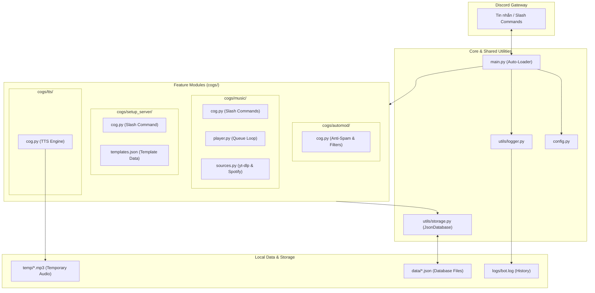

# 🤖 SosaPy — All-in-One Discord Bot

<p align="center">
  <b>Hệ thống Discord Bot đa chức năng, kiến trúc từng tính năng một thư mục riêng biệt (Feature-Folder Architecture), tích hợp JSON Database siêu nhẹ và an toàn.</b>
</p>

<p align="center">
  
  
  
  
</p>

---

## 📑 Mục Lục
- [1. Giới Thiệu Dự Án](#1-giới-thiệu-dự-án)
- [2. Trả Lời: Có Thể Dùng JSON Thay Thế Database Không?](#2-trả-lời-có-thể-dùng-json-thay-thế-database-không)
- [3. Kiến Trúc Hệ Thống](#3-kiến-trúc-hệ-thống)
- [4. Cấu Trúc Thư Mục Chuẩn Hóa (Mỗi Tính Năng 1 Folder)](#4-cấu-trúc-thư-mục-chuẩn-hóa-mỗi-tính-năng-1-folder)
- [5. Hướng Dẫn Cài Đặt Chi Tiết](#5-hướng-dẫn-cài-đặt-chi-tiết)
- [6. Cấu Hình Biến Môi Trường (.env)](#6-cấu-hình-biến-môi-trường-env)
- [7. Hướng Dẫn Sử Dụng & Bảng Lệnh (Slash Commands)](#7-hướng-dẫn-sử-dụng--bảng-lệnh-slash-commands)
- [8. Cách Sử Dụng JSON Database Trong Mã Nguồn](#8-cách-sử-dụng-json-database-trong-mã-nguồn)
- [9. Hướng Dẫn Thêm Tính Năng Mới (Tạo Folder Riêng)](#9-hướng-dẫn-thêm-tính-năng-mới-tạo-folder-riêng)
- [10. Nhật Ký Cập Nhật & Tiến Độ Làm Việc (Worklog & Changelog)](#10-nhật-ký-cập-nhật--tiến-độ-làm-việc-worklog--changelog)
- [11. Kế Hoạch Phát Triển (Roadmap)](#11-kế-hoạch-phát-triển-roadmap)

---

## 1. Giới Thiệu Dự Án

**SosaPy** là một Discord Bot được thiết kế theo kiến trúc **Feature-Folder (Vertical Slice Architecture)**: mỗi tính năng lớn được đóng gói hoàn toàn trong một thư mục riêng biệt (chứa code lệnh, logic nội bộ, class hỗ trợ và dữ liệu mẫu riêng).

Hệ thống cung cấp 4 khối tính năng chính:
1. **Âm nhạc đa nguồn (Music Engine):** YouTube, SoundCloud, Spotify, tìm kiếm từ khóa, quản lý hàng đợi và tác vụ nền theo từng server.
2. **Text-To-Speech (TTS tiếng Việt):** Chuyển văn bản thành giọng nói trực tiếp trong phòng thoại bằng Google TTS, tự động dọn dẹp file tạm.
3. **Quản trị an ninh (AutoMod):** Lọc từ cấm, chặn link rác ngoài danh mục, chống spam tin nhắn liên tục và phạt timeout 5 phút.
4. **Khởi tạo Server mẫu (Setup Server):** Tự động tạo Categories, Channels, Roles và Phân quyền riêng tư chỉ bằng 1 lệnh từ file template JSON tùy biến.

---

## 2. Trả Lời: Có Thể Dùng JSON Thay Thế Database Không?

> [!TIP]
> **CÂU TRẢ LỜI:** **HOÀN TOÀN CÓ THỂ, VÀ RẤT PHÙ HỢP CHO DỰ ÁN NÀY!**

### ✅ Vì sao JSON là lựa chọn tuyệt vời cho bot quy mô vừa và nhỏ?
- **Siêu nhẹ & Tiện lợi:** Không cần cài đặt MySQL, PostgreSQL, Docker hay cấu hình server database phức tạp.
- **Dễ chỉnh sửa & Sao lưu:** Dữ liệu nằm ngay trong thư mục `data/` dưới dạng file text `.json`. Bạn có thể mở ra xem, copy backup hoặc sửa tay một cấu hình server bất cứ lúc nào.
- **Rất phù hợp để lưu:**
  - Cấu hình server (kênh thông báo, kênh nghe nhạc, prefix).
  - Danh sách từ cấm riêng theo từng guild.
  - Template mẫu của server.
  - Thống kê level / tiền tệ / cảnh báo vi phạm đơn giản.

### ⚠️ Rủi ro cần phòng tránh khi dùng JSON làm Database
Trong bot Discord, các sự kiện diễn ra **bất đồng bộ (asynchronous)**: Nếu 2 người dùng cùng gõ lệnh ghi dữ liệu vào file JSON cùng một mili-giây, file JSON có thể bị lỗi xung đột ghi đè (**Race Condition**) hoặc bị trắng file (corrupt).

### 🛡️ Giải pháp SosaPy đã tích hợp sẵn: `utils.storage.JsonDatabase`
Dự án đã xây dựng sẵn module [utils/storage.py](file:///d:/VHD_Files/Tools/Tools/DiscordBot/SosaPy/utils/storage.py) với 2 cơ chế bảo vệ tối cao:
1. **Async Lock (`asyncio.Lock`):** Đảm bảo tại một thời điểm chỉ có 1 tác vụ được phép ghi file, loại bỏ 100% tình trạng xung đột ghi đè.
2. **Atomic Write (Ghi nguyên tử):** Dữ liệu được ghi ra một file đệm `.tmp` trước. Sau khi ghi thành công trọn vẹn, hệ thống mới đổi tên thay thế file chính thức. Nếu bot bị cúp điện hay tắt đột ngột, file gốc không bao giờ bị hỏng.

---

## 3. Kiến Trúc Hệ Thống



---

## 4. Cấu Trúc Thư Mục Chuẩn Hóa (Mỗi Tính Năng 1 Folder)

Dự án hiện tại đã được tách bạch rành mạch 100%:

```text
SosaPy/
├── .env                          # Lưu biến môi trường bí mật (Token, Keys) - KHÔNG ĐẨY LÊN GIT
├── .env.example                  # Mẫu cấu hình môi trường
├── .gitignore                    # Loại bỏ cache, file tạm, file database nhạy cảm khỏi Git
├── config.py                     # Quản lý tập trung toàn bộ cấu hình hệ thống
├── main.py                       # Khởi chạy bot: tự động nạp mọi thư mục cogs/
├── requirements.txt              # Danh sách thư viện cần thiết
├── README.md                     # Tài liệu trung tâm
│
├── cogs/                         # THƯ MỤC CÁC CHỨC NĂNG (MỖI CHỨC NĂNG 1 FOLDER)
│   ├── music/                    # [CHỨC NĂNG 1] HỆ THỐNG NGHE NHẠC
│   │   ├── __init__.py           # Export hàm nạp cog
│   │   ├── cog.py                # Các lệnh Slash Command (/play, /pause, /skip...)
│   │   ├── player.py             # Class MusicPlayer: Quản lý Queue & vòng lặp phát nhạc
│   │   └── sources.py            # Xử lý luồng âm thanh YouTube, SoundCloud, Spotify
│   │
│   ├── setup_server/             # [CHỨC NĂNG 2] THIẾT LẬP MÁY CHỦ MẪU
│   │   ├── __init__.py           # Export hàm nạp cog
│   │   ├── cog.py                # Lệnh Slash Command (/setup-server)
│   │   └── templates.json        # Dữ liệu JSON mô tả các Category, Channel và Quyền hạn
│   │
│   ├── tts/                      # [CHỨC NĂNG 3] CHUYỂN VĂN BẢN THÀNH GIỌNG NÓI
│   │   ├── __init__.py           # Export hàm nạp cog
│   │   └── cog.py                # Lệnh /speak, tích hợp gTTS và dọn dẹp file tạm
│   │
│   └── automod/                  # [CHỨC NĂNG 4] TỰ ĐỘNG QUẢN TRỊ SERVER
│       ├── __init__.py           # Export hàm nạp cog
│       └── cog.py                # Listener on_message: lọc từ cấm, chặn link, chống spam
│
├── data/                         # THƯ MỤC CƠ SỞ DỮ LIỆU JSON
│   └── .gitkeep                  # Lưu các file dữ liệu bot (ví dụ: guild_configs.json)
│
├── utils/                        # CÁC TIỆN ÍCH DÙNG CHUNG TOÀN HỆ THỐNG
│   ├── __init__.py
│   ├── logger.py                 # Hệ thống ghi log (Console + Rotating File bot.log)
│   └── storage.py                # Bộ điều khiển JSON Database an toàn (Lock + Atomic)
│
├── logs/                         # Lưu trữ file log lịch sử (bot.log)
└── temp/                         # Chứa file âm thanh .mp3 tạm thời khi đọc TTS
```

---

## 5. Hướng Dẫn Cài Đặt Chi Tiết

### 1. Yêu cầu tiên quyết
- **Python**: Phiên bản 3.10 trở lên (khuyên dùng Python 3.12).
- **FFmpeg**: Bắt buộc để phát âm thanh trong voice channel ([Hướng dẫn cài FFmpeg Windows](https://www.gyan.dev/ffmpeg/builds/)).
- **Discord Bot Token**: Lấy tại [Discord Developer Portal](https://discord.com/developers/applications) (nhớ bật đủ 3 Privileged Intents).

### 2. Cài đặt thư viện
```bash
# Tạo môi trường ảo
python -m venv venv

# Kích hoạt trên Windows PowerShell:
.\venv\Scripts\Activate.ps1
# Hoặc trên Linux/macOS:
source venv/bin/activate

# Cài đặt dependencies:
pip install -r requirements.txt
```

### 3. Cấu hình và chạy
1. Sao chép `.env.example` thành `.env`:
   ```bash
   cp .env.example .env   # Linux/macOS
   Copy-Item .env.example .env  # Windows PowerShell
   ```
2. Điền token của bạn vào file `.env`.
3. Chạy bot:
   ```bash
   python main.py
   ```

---

## 6. Cấu Hình Biến Môi Trường (.env)

| Tên biến | Kiểu dữ liệu | Giải thích chi tiết |
| :--- | :--- | :--- |
| `DISCORD_TOKEN` | String | Token bảo mật của Bot. |
| `COMMAND_PREFIX` | String | Tiền tố lệnh (mặc định: `!`). |
| `SETUP_MASTER_KEY`| String | Mã bảo mật bắt buộc phải nhập khi chạy `/setup-server`. |
| `BAD_WORDS` | String | Danh sách từ ngữ cấm (cách nhau bởi dấu phẩy `,`). |
| `SPAM_LIMIT` | Integer | Số tin nhắn tối đa trong khung thời gian quy định (mặc định: `5`). |
| `SPAM_TIME` | Integer | Khung thời gian kiểm tra spam tính bằng giây (mặc định: `3`). |
| `LOG_LEVEL` | String | Mức độ log: `INFO`, `DEBUG`, `WARNING`, `ERROR`. |

---

## 7. Hướng Dẫn Sử Dụng & Bảng Lệnh (Slash Commands)

### Nhóm Âm Nhạc (`cogs/music/`)
- `/play <query>`: Phát nhạc từ link YouTube, SoundCloud, Spotify hoặc tìm kiếm từ khóa.
- `/pause`: Tạm dừng bài hát.
- `/resume`: Tiếp tục phát nhạc.
- `/skip`: Chuyển sang bài kế tiếp trong hàng đợi.
- `/queue`: Hiển thị danh sách phát hiện tại.
- `/leave`: Rời khỏi phòng thoại và xóa hàng đợi.

### Nhóm Giao Tiếp Voice (`cogs/tts/`)
- `/speak <text>`: Đọc văn bản tiếng Việt thành giọng nói trong kênh thoại.

### Nhóm Quản Trị Server (`cogs/setup_server/`)
- `/setup-server <clear_old> <security_code>`: Tự động khởi tạo cấu trúc kênh, role theo file mẫu `templates.json` (chỉ Chủ Server + đúng Master Key mới dùng được).

### Nhóm Tự Động Hóa Chạy Ngầm (`cogs/automod/`)
- Tự động xóa tin nhắn vi phạm từ ngữ cấm.
- Tự động chặn và xóa tin nhắn gửi liên kết ngoài.
- Tự động timeout 5 phút đối với thành viên spam tin nhắn liên tục.

---

## 8. Cách Sử Dụng JSON Database Trong Mã Nguồn

Khi bạn muốn lưu trữ dữ liệu (ví dụ: điểm kinh tế, tiền xu, thiết lập riêng của từng server), hãy sử dụng class `JsonDatabase` trong [utils/storage.py](file:///d:/VHD_Files/Tools/Tools/DiscordBot/SosaPy/utils/storage.py):

```python
from config import Config
from utils.storage import JsonDatabase

# 1. Khởi tạo database trỏ đến file JSON trong thư mục data/
# Kèm theo dữ liệu mặc định ban đầu nếu file chưa tồn tại
db = JsonDatabase(Config.DATA_DIR / "guild_settings.json", default_data={})

# 2. Đọc dữ liệu (Hỗ trợ Cache & Async)
prefix = await db.get("prefix", default="!")

# 3. Ghi dữ liệu an toàn (Tự động khóa Lock và ghi Atomic)
await db.set("prefix", "?")
await db.set(f"welcome_channel_{guild_id}", 123456789)

# 4. Lấy toàn bộ dữ liệu
all_data = await db.all()
```

---

## 9. Hướng Dẫn Thêm Tính Năng Mới (Tạo Folder Riêng)

Nhờ cơ chế **Folder-based Auto-Discovery** trong [main.py](file:///d:/VHD_Files/Tools/Tools/DiscordBot/SosaPy/main.py), bạn chỉ cần:

1. **Tạo thư mục mới** bên trong `cogs/` (ví dụ: `cogs/economy/`).
2. **Tạo file `cogs/economy/__init__.py`**:
   ```python
   from .cog import setup
   __all__ = ["setup"]
   ```
3. **Tạo file `cogs/economy/cog.py`**:
   ```python
   import discord
   from discord.ext import commands
   from discord import app_commands

   class Economy(commands.Cog):
       def __init__(self, bot: commands.Bot):
           self.bot = bot

       @app_commands.command(name="balance", description="Xem số dư xu của bạn")
       async def balance(self, interaction: discord.Interaction):
           await interaction.response.send_message("💰 Số dư của bạn: 1,000 Xu")

   async def setup(bot: commands.Bot):
       await bot.add_cog(Economy(bot))
   ```
4. Khởi động lại bot. Bot sẽ tự động quét thấy thư mục `cogs.economy` và đồng bộ lệnh ngay lập tức!

---

## 10. Nhật Ký Cập Nhật & Tiến Độ Làm Việc (Worklog & Changelog)

| Phiên bản | Ngày cập nhật | Người thực hiện | Nội dung chi tiết |
| :---: | :---: | :---: | :--- |
| **v1.3.0** | 2026-11-23 | Antigravity & User | **Rà soát bảo mật & Khắc phục xung đột hệ thống:**<br>• Đồng bộ hóa Voice giữa TTS và Music, chống lỗi `ClientException: Already playing audio`.<br>• Chuyển các tác vụ I/O đồng bộ (Spotify metadata, gTTS save) sang `asyncio.to_thread` chống nghẽn Event Loop.<br>• Vá lỗ hổng DoS TTS bằng cách giới hạn ký tự tối đa `TTS_MAX_LENGTH=300`.<br>• Khắc phục rò rỉ bộ nhớ (Memory Leak) trong dictionary chống spam của AutoMod.<br>• Chống bão request Discord Rate Limit (HTTP 429) trong lệnh `/setup-server`.<br>• Chống bắt cóc bot giữa các kênh thoại khi đang có người nghe. |
| **v1.2.0** | 2026-11-23 | Antigravity & User | **Tái cấu trúc Feature-Folder & Tích hợp JSON Database:**<br>• Tách mỗi tính năng thành 1 folder riêng trong `cogs/` (`music/`, `setup_server/`, `tts/`, `automod/`).<br>• Tách `player.py` và `sources.py` trong module Music giúp code gọn gàng, rành mạch.<br>• Tách cấu trúc Server thành file riêng `cogs/setup_server/templates.json`.<br>• Xây dựng module `utils/storage.py` (`JsonDatabase`) với Async Lock và Atomic Write.<br>• Nâng cấp `main.py` tự động quét cả Folder Cogs và File Cogs.<br>• Cập nhật toàn bộ tài liệu hướng dẫn `README.md`. |
| **v1.1.0** | 2026-11-23 | Antigravity & User | **Chuẩn hóa Enterprise Architecture:** Tách `.env`, `config.py`, `utils/logger.py`, `.gitignore`, `requirements.txt`. |
| **v1.0.0** | 2026-07-10 | User | **Khởi tạo dự án ban đầu:** 4 cogs phẳng cơ bản (`music.py`, `tts.py`, `automod.py`, `setup.py`). |

---

## 11. Kế Hoạch Phát Triển (Roadmap)

- [ ] **Lưu trữ cấu hình Guild vào JSON Database:** Cho phép mỗi server tự chỉnh prefix, bật/tắt AutoMod riêng biệt qua `data/guild_configs.json`.
- [ ] **Interactive Buttons cho Music:** Thêm hàng nút Pause, Skip, Stop dưới bài hát đang phát.
- [ ] **Hệ thống Welcome Banner:** Tạo ảnh thẻ chào mừng tự động lưu ảnh tạm trong `temp/`.
- [ ] **Hệ thống Ticket:** Mở kênh chat riêng với Ban Quản Trị bằng Discord Button.
- [ ] **Hệ thống Level / Rank:** Tính điểm kinh nghiệm chat lưu trực tiếp bằng `JsonDatabase`.

---

<p align="center">
  Được phát triển với đam mê và tinh thần mã nguồn mở ❤️<br>
  <i>Tài liệu này được duy trì và cập nhật liên tục theo tiến trình phát triển dự án.</i>
</p>
